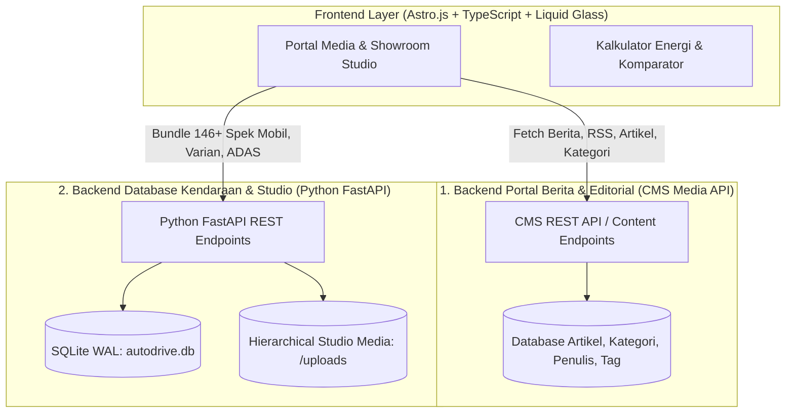

# 📊 LAPORAN LENGKAP PROGRES PENGEMBANGAN SISTEM (CMS MEDIA OTOMOTIF & EVNESIA)

> **Dokumen Rekapitulasi Progres Proyek & Spesifikasi Sistem**  
> **Proyek:** Portal Media Otomotif & Database Kendaraan Listrik (EVnesia / AutoDrive CMS)  
> **Tech Stack Utama:** Astro.js, TailwindCSS / Custom Liquid Glass CSS, TypeScript, Python (FastAPI/SQLite), SQLite Database.  
> **Terakhir Diperbarui:** 2026-10-11  

---

## 📌 DAFTAR ISI
1. [Ringkasan Eksekutif](#1-ringkasan-eksekutif)
2. [Arsitektur Sistem Terpisah (Multi-Backend Architecture)](#2-arsitektur-sistem-terpisah-multi-backend-architecture)
3. [Fitur-Fitur Lengkap Platform Web](#3-fitur-fitur-lengkap-platform-web)
4. [Informasi & Data yang Disajikan](#4-informasi--data-yang-disajikan)
5. [Modul Interaktif & Tools Unggulan](#5-modul-interaktif--tools-unggulan)
6. [Backend, API, & Pipeline Data](#6-backend-api--pipeline-data)
7. [Desain Sistem, Performa, SEO, & Aksesibilitas (A11y)](#7-desain-sistem-performa-seo--aksesibilitas-a11y)
8. [Struktur Berkas Proyek](#8-struktur-berkas-proyek)
9. [Rekapitulasi Milestone & Riwayat Progres](#9-rekapitulasi-milestone--riwayat-progres)

---

## 1. Ringkasan Eksekutif

Platform ini dibangun sebagai ekosistem digital terpadu media otomotif modern generasi baru berbasis **Astro.js** dengan fokus khusus pada era elektrifikasi kendaraan (BEV, PHEV, HEV) di Indonesia (*EVnesia*).

Platform ini mengintegrasikan portal publikasi berita jurnalistik berkualitas tinggi dengan *showroom studio* interaktif berstandar industri (terinspirasi dari estetika minimalis Polestar & XPENG), basis data teknis mendalam dari brosur resmi APM, kalkulator efisiensi biaya energi, dan modul komparasi kendaraan komprehensif.

---

## 2. Arsitektur Sistem Terpisah (Multi-Backend Architecture)

Sistem ini dirancang menggunakan **arsitektur backend terpisah (*Decoupled Architecture*)** untuk memisahkan beban kerja konten editorial media dari beban kerja basis data teknis otomotif:



### 💡 Mengapa Menggunakan Backend Terpisah?

1. **Backend Portal Berita & Editorial (CMS Media):**
   * **Fokus:** Mengelola artikel berita, ulasan mendalam (*in-depth review*), galeri foto/video, peliputan acara peluncuran, indeks berita, manajemen redaksi/jurnalis, serta *feed* RSS/Sitemap publikasi media.
   * **Manfaat:** Tim redaksi dan penulis berita dapat mempublikasikan konten secara dinamis dan cepat tanpa menyentuh struktur data teknis kendaraan.

2. **Backend Khusus Kendaraan & Media Studio (Automotive Intelligence Backend):**
   * **Fokus:** Ditenagai oleh **Python FastAPI** (`backend/`) dengan basis data **SQLite** (`autodrive.db` / `evnesia.db`) dan **Rust Microservice** (`backend-rust/`). Khusus memproses data terstruktur 184+ model mobil/motor listrik, varian trim, matriks keselamatan ADAS, simulasi kalkulator energi, serta manajemen media aset foto studio dan logo brand (`backend/uploads/`).
   * **Manfaat:** Menjamin integritas dan validitas spesifikasi teknis mobil dari brosur resmi, mencegah anomali data, serta memastikan performa tinggi saat melakukan query spesifikasi dan kalkulasi perbandingan yang rumit.

3. **Keunggulan Skalabilitas:**
   * Lonjakan trafik pada berita viral (*breaking news*) tidak mengganggu performa modul komparasi atau database spesifikasi mobil, dan sebaliknya.

---

## 3. Fitur-Fitur Lengkap Platform Web

### 🌐 A. Navigasi & Direktori Brand
* **Apple-Style Liquid Glass Capsule Header:** Bilah navigasi melayang (*floating capsule*) dengan efek blur, refleksi spekular, dan border dinamis.
* **Liquid Glass Brand Hub Popover & Drawer:** Menu popover interaktif 2-3 baris horizontal slider untuk akses instan ke seluruh brand otomotif (BYD, Hyundai, Wuling, Chery, BMW, Zeekr, Denza, Aletra, Seres, MG, dll.).
* **Pencarian Cepat (Live In-Memory Search):** Filter instan berdasarkan nama model, jenis penggerak, kapasitas baterai, tipe bodi, atau rentang harga.

### 🏎️ B. Showroom Studio & Detail Mobil (`/mobil/[slug]`)
* **Split-Studio Showcase Layout:** Tata letak studio modern yang memisahkan stage foto kendaraan beresolusi tinggi dengan panel kendali spesifikasi.
* **Interactive Model & Trim Switcher:** Navigasi perpindahan varian/trim tanpa jeda muat ulang halaman.
* **Blueprint Dimension Wireframe:** Diagram interaktif visual dimensi bodi mobil (Panjang, Lebar, Tinggi, Wheelbase, Ground Clearance, dan Bagasi).
* **Bento Glass Master Spec Cards:** Kartu spesifikasi bergaya kaca modern yang mengelompokkan data baterai, motor listrik, performa, dan fitur kenyamanan.
* **ADAS Breakdown Matrix Table:** Matriks perbandingan fitur keselamatan aktif per varian (*Adaptive Cruise Control, Lane Keep Assist, Blind Spot Monitoring, 360 Camera*, dll.).
* **Mobile Sticky Action Dock:** Panel aksi cepat melayang di perangkat mobile untuk unduh brosur PDF resmi, simulasi kredit, atau booking test drive.

### 📚 C. Portal Berita, Artikel, & Editorial
* **Headline & Sorotan Berita Utama:** Kurasi visual artikel terkini dan tren industri otomotif.
* **Navigasi Kategori Lengkap:** Mobil Listrik (BEV), Hybrid (PHEV/HEV), Motor Listrik, Komponen & Baterai, Regulasi & Kebijakan, Tips & Panduan.
* **Indeks Berita & Arsip Dinamis:** Pencarian artikel berdasarkan tanggal, kategori, dan tag topik.
* **Fitur Terkait & Rekomendasi Pintar:** Widget *Baca Juga* dan *Berita Terkait* di dalam artikel untuk meningkatkan retensi pembaca.
* **Profil Penulis & Redaksi:** Informasi biografi jurnalis, total artikel yang diterbitkan, dan transparansi redaksional.
* **Halaman Kepatuhan Media & Legal:**
  - Pedoman Pemberitaan Media Siber.
  - Pedoman Kecerdasan Buatan (Transparansi Penggunaan AI).
  - Kebijakan Privasi, Hak Jawab, Kontak Redaksi, & Pasang Iklan.

---

## 4. Informasi & Data yang Disajikan

Platform ini menyajikan informasi yang sangat komprehensif, terstruktur, dan tervalidasi langsung dari brosur resmi APM:

### ⚡ A. Data Spesifikasi Teknis Kendaraan (Database)
1. **Performa & Powertrain:**
   - Standardisasi daya ganda: **kW (Kilowatt)** dan **PS / HP**.
   - Torsi Puncak (**Nm**).
   - Akselerasi 0–100 km/jam (detik) dan Kecepatan Maksimum (km/h).
   - Sistem Penggerak Roda (FWD, RWD, Dual-Motor AWD).
2. **Baterai & Pengisian Daya (Charging):**
   - Kapasitas Baterai Bawaan (**kWh**) dan Kimia Sel (*Blade LFP / Ternary NMC*).
   - Estimasi Jarak Tempuh Maksimal (**NEDC / CLTC / WLTP**).
   - Durasi Pengisian Normal AC (*Home Charging* 0–100%).
   - Durasi Pengisian Cepat DC Fast Charging (10–80% atau 30–80%) beserta input daya maksimum (kW).
3. **Dimensi, Bobot, & Ruang:**
   - Panjang x Lebar x Tinggi (mm).
   - Jarak Sumbu Roda / *Wheelbase* (mm).
   - *Ground Clearance* (mm) & Radius Putar (m).
   - Kapasitas Penumpang (*Seating Capacity*: 5-Seater / 6-Seater Captain Seat / 7-Seater).
   - Kapasitas Bagasi Standar & Ekspansi (Liter) serta *Frunk* (bagasi depan).
4. **Paket Penjualan, Garansi, & Harga Resmi:**
   - Harga OTR Indonesia (estimasi Jakarta / Nasional) per varian.
   - Status Insentif PPN Pemerintah (1%).
   - Paket Pembelian (*Free Wallbox 7 kW, Portable Charger, V2L Adapter*).
   - Garansi Baterai (Traction Battery: misal 8 Tahun / 160.000 km) dan Garansi Umum Kendaraan.

### 📰 B. Informasi Berita & Industri Media
* Berita terkini mengenai peluncuran unit baru, kebijakan insentif pemerintah, dan ulasan mendalam (*test drive*).
* Panduan praktis bagi pemilik kendaraan listrik (cara merawat baterai, tips pasang home charging daya PLN, etika di SPKLU).
* Foto resolusi tinggi dan video peluncuran produk otomotif.

### 🔌 C. Informasi Infrastruktur & Ekosistem
* Direktori jaringan SPKLU nasional, jenis socket yang didukung (CCS2, Type 2, CHAdeMO, GB/T), serta tarif per kWh.
* Informasi motor listrik: sistem *battery swap* vs colok mandiri, serta skema motor subsidi.

---

## 5. Modul Interaktif & Tools Unggulan

| Modul Interaktif | Lokasi Halaman | Deskripsi & Manfaat Bagi Pengguna |
| :--- | :--- | :--- |
| **Kalkulator Biaya Energi (EV vs Bensin)** | [`/kalkulator.astro`](file:///d:/Project%20Magang%20Minggu%201/CMS-Media-main/src/pages/kalkulator.astro) | Simulasi perbandingan riil pengeluaran bulanan/tahunan antara konsumsi kWh listrik (Rp 1.699 - Rp 2.466/kWh) vs BBM (Pertalite/Pertamax/Solar), perhitungan penghematan emisi CO2, dan estimasi waktu balik modal (*break-even point*). |
| **Komparator Multi-Kendaraan** | [`/komparasi.astro`](file:///d:/Project%20Magang%20Minggu%201/CMS-Media-main/src/pages/komparasi.astro) | Membandingkan secara langsung hingga 3 mobil berbeda dalam satu layar *side-by-side* dengan preset perbandingan populer dan penanda perbedaan spesifikasi secara otomatis. |
| **Estimator Waktu Isi Daya (Charging Estimator)** | In-Showroom Widget | Memperkirakan waktu tunggu pengisian daya berdasarkan sumber listrik (Stopkontak Rumah 2.2 kW, Wallbox 7–22 kW, hingga SPKLU Ultra Fast Charging 150–350 kW). |
| **Direktori SPKLU** | [`/spklu.astro`](file:///d:/Project%20Magang%20Minggu%201/CMS-Media-main/src/pages/spklu.astro) | Peta dan panduan lokasi pengisian daya umum beserta filter tipe konektor. |
| **Katalog Roda Dua Listrik** | [`/katalog-motor.astro`](file:///d:/Project%20Magang%20Minggu%201/CMS-Media-main/src/pages/katalog-motor.astro) | Direktori khusus motor listrik di Indonesia beserta opsi baterai dan harga setelah subsidi. |

---

## 6. Backend, API, & Pipeline Data

* **Python FastAPI Micro-Backend (`/backend`):**
  - REST API endpoint untuk manajemen data mobil, varian, dan brand.
  - Endpoint upload media studio terisolasi dan aman.
  - Script otomatisasi pipeline data:
    - [`manage.py`](file:///d:/Project%20Magang%20Minggu%201/CMS-Media-main/backend/manage.py): Manajemen database CLI.
    - [`seed.py`](file:///d:/Project%20Magang%20Minggu%201/CMS-Media-main/backend/seed.py): Ingest dan sinkronisasi ratusan model & varian.
    - [`export_frontend_cars.py`](file:///d:/Project%20Magang%20Minggu%201/CMS-Media-main/backend/export_frontend_cars.py): Konversi dataset database menjadi artefak TypeScript / JSON statis siap pakai untuk performa frontend instan.
    - [`organize_hierarchical_uploads.py`](file:///d:/Project%20Magang%20Minggu%201/CMS-Media-main/backend/organize_hierarchical_uploads.py): Pengelompokan aset gambar ke `uploads/[brand]/[model]/`.
* **Rust Backend Microservice (`/backend-rust`):**
  - Layanan mikro performa tinggi untuk pemrosesan data, indexing, dan kalkulasi instan.

---

## 7. Desain Sistem, Performa, SEO, & Aksesibilitas (A11y)

* **Performa Ekstrem & Core Web Vitals:**
  - Konversi 149+ aset gambar ke format WebP modern berukuran kecil dengan ketajaman maksimal.
  - Implementasi `decoding="async"`, `loading="lazy"`, serta preload banner LCP.
  - Navigasi instan dengan **Hover Prefetching**.
* **Aksesibilitas (A11y):**
  - *High-contrast focus indicators* untuk navigasi ramah disabilitas.
  - Struktur label semantik ARIA (`aria-expanded`, `aria-controls`, `aria-label`).
  - Dukungan navigasi keyboard penuh (tombol `Escape`, trap focus pada drawer modal).
* **SEO & Metadata:**
  - Otomatisasi OpenGraph, Twitter Cards, dan Schema.org (`Car`, `Vehicle`, `NewsArticle`).
  - Feed RSS otomatis ([`rss.xml.ts`](file:///d:/Project%20Magang%20Minggu%201/CMS-Media-main/src/pages/rss.xml.ts)) & Sitemap Dinamis ([`sitemap.xml.ts`](file:///d:/Project%20Magang%20Minggu%201/CMS-Media-main/src/pages/sitemap.xml.ts)).

---

## 8. Struktur Berkas Proyek

```plaintext
CMS-Media-main/
├── backend/                  # Layanan API Python FastAPI, database SQLite & pipeline data
│   ├── app/                  # Router, schema, models & database connection tuning (WAL)
│   ├── autodrive.db          # Database SQLite utama spesifikasi mobil (Indexed)
│   ├── seed.py               # Script database seeding dari brosur resmi
│   ├── export_frontend_cars.py # Pipeline export data ke frontend
│   ├── brosur/               # Arsip PDF brosur resmi APM
│   └── uploads/              # Direktori aset foto kendaraan bertingkat per brand/model
├── backend-rust/             # Layanan microservice berbasis Rust untuk pemrosesan cepat
├── docs/                     # Dokumentasi teknis sistem, ERD/LRS, dan dokumen spesifikasi UI/UX
├── public/                   # File statis, logo SVG brand, favicon, manifest PWA
├── src/
│   ├── components/           # Komponen global (BannerAd, GoogleAnalytics, dll.)
│   ├── data/                 # Dataset statis TypeScript & electrified-cars.json (146 model)
│   ├── database/             # Modul query database lokal
│   ├── lib/                  # API client berita, theme resolver, format helpers
│   ├── pages/                # File routing Astro (Showroom, Komparator, Kalkulator, SPKLU)
│   │   ├── mobil/            # Dynamic route /mobil/[slug]
│   │   ├── katalog-mobil/    # Halaman katalog & filter mobil
│   │   ├── kalkulator.astro  # Dedicated page kalkulator bensin vs EV
│   │   ├── komparasi.astro   # Dedicated page komparasi kendaraan
│   │   └── spklu.astro       # Dedicated page peta/direktori SPKLU
│   └── themes/
│       ├── Automotive/       # Desain Utama: Template desktop/portal media otomotif (EVnesia)
│       └── evnesia-v2/       # Desain Revisi V2: Mobile-first responsive app-like theme
├── astro.config.mjs          # Konfigurasi Astro.js, Tailwind v4, Vite, Prefetching & Sitemap
└── PROGRESS_PROYEK.md        # Dokumen rekapitulasi progres ini
```

---

## 9. Rekapitulasi Milestone & Riwayat Progres

| Periode | Fokus Utama | Capaian Utama |
| :--- | :--- | :--- |
| **Minggu 1 – Setup & Fondasi Database** | Basis Data & Skema Kendaraan | Pembuatan skema SQLite `CarSpec`, `CarVariant`, `WallChargerInfo`, serta master prompt ekstraksi brosur AI. |
| **Minggu 2 – Showroom Studio & Visual UI** | Desain Showroom XPENG & Liquid Glass | Transformasi halaman detail mobil menjadi split-studio modern, penghapusan border kaku, dan perombakan header kaca cair. |
| **Minggu 3 – Sinkronisasi Data 184+ Model** | Integrasi Brosur & Metrik Standar | Standardisasi metrik kW/PS dan Nm, rekonsiliasi varian BYD, Chery, Hyundai, Wuling, Zeekr, serta perbaikan tabel ADAS & spesifikasi bento. |
| **Minggu 4 – Fitur Interaktif & Optimasi Aset** | Kalkulator, Komparasi, & WebP | Implementasi kalkulator konsumsi energi, konversi 149 gambar ke WebP, komparator kendaraan, blueprint wireframe, dan prefetching klien. |
| **Minggu 5 – Konsolidasi Desain (V2 Mobile-First & Utama)** | Finalisasi V2, Animasi Fluida & Optimasi | Pembersihan template legacy (v1, console-glass, motor-listrik), integrasi sistem fisika animasi (`--ease-fluid`, `--ease-spring`), kalkulator rolling ticker, indexing database SQLite WAL, dan perapian struktur `docs/`. |
| **Minggu 6 – Audit Penuh & Zero-Problem QA** | Kualitas Kode, Kontras & Bebas Error | Pembersihan seluruh problem & error TypeScript (`0 errors` pada `astro check` & `tsc`), kalibrasi kontras warna kartu (*glass elevation*), optimalisasi tipografi responsif mobile tanpa *collision*, dan perbaikan navigasi langsung `/mobil/[slug]`. |
| **Minggu 7 – Enhancement Interaktif Komparator & Video Media** | Komparator V2 Overlay & Multi-Video Spotlight | Redesain pemilih mobil komparasi menjadi *frosted glass floating overlay* dengan *background blur* (`backdrop-blur-2xl`), logo resmi APM/brand di setiap pill filter & car card, integrasi multi-video YouTube spotlight, dan tata letak responsif mobile yang rapi. |
| **Minggu 8 – Audit Total & Sinkronisasi Brosur Resmi A-Z** | Validasi 147 Model Mobil Elektrifikasi | Audit komprehensif seluruh merek A–Z terhadap 40+ brosur resmi PDF APM (`backend/brosur/`), koreksi klasifikasi mesin (BEV/HEV/PHEV), pemisahan model duplikat (Chery J6 vs J6T, Honda e:N1 vs Super-ONE), penambahan model baru (BMW i7, Hyundai Ioniq 9), eliminasi anomali baterai/range, pembersihan 100% missing images, dan pembuatan katalog navigasi lengkap `DAFTAR_URL.md`. |

---

*Laporan ini disusun secara otomatis sebagai dokumentasi resmi progres pengembangan sistem CMS Media Otomotif & EVnesia.*
