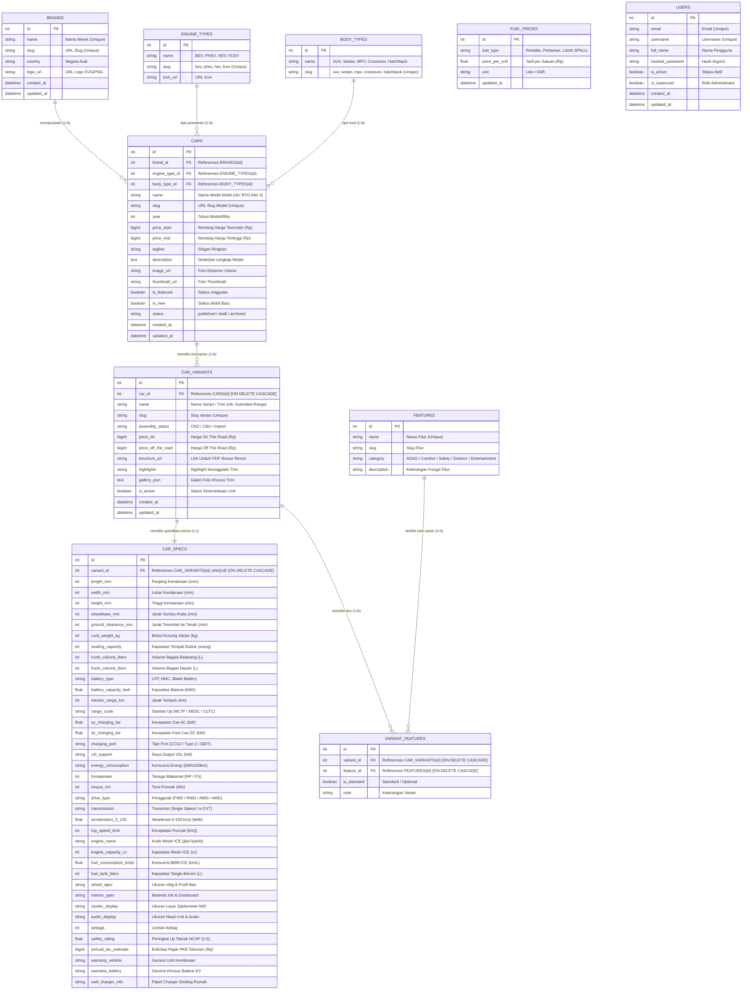

# Dokumentasi Lengkap Skema Database EVnesia (Standard Industri Otomotif)

Dokumen ini memuat spesifikasi rancangan database relasional yang telah disempurnakan untuk menampung seluruh data teknis, harga OTR/Off-the-Road, siklus pengujian baterai, sistem pengecasan, serta normalisasi fitur (*Many-to-Many*).

---

## 1. Entity Relationship Diagram (ERD)



---

## 2. Logical Record Structure (LRS)

```
[ BRANDS ]
----------------------------------------------------------------------
* id                      : INTEGER (PK)
  name                    : VARCHAR(100)
  slug                    : VARCHAR(100) (UNIQUE)
  country                 : VARCHAR(80)
  logo_url                : VARCHAR(500)
  created_at              : DATETIME
  updated_at              : DATETIME
         |
         | 1:N
         v
[ CARS ]
----------------------------------------------------------------------
* id                      : INTEGER (PK)
# brand_id                : INTEGER (FK -> BRANDS.id) [ON DELETE CASCADE]
# engine_type_id          : INTEGER (FK -> ENGINE_TYPES.id)
# body_type_id            : INTEGER (FK -> BODY_TYPES.id)
  name                    : VARCHAR(200)
  slug                    : VARCHAR(200) (UNIQUE)
  year                    : INTEGER
  price_start             : BIGINT
  price_end               : BIGINT
  tagline                 : VARCHAR(300)
  description             : TEXT
  image_url               : VARCHAR(500)
  thumbnail_url           : VARCHAR(500)
  is_featured             : BOOLEAN
  is_new                  : BOOLEAN
  status                  : VARCHAR(12)
  created_at              : DATETIME
  updated_at              : DATETIME
         |
         | 1:N
         v
[ CAR_VARIANTS ]
----------------------------------------------------------------------
* id                      : INTEGER (PK)
# car_id                  : INTEGER (FK -> CARS.id) [ON DELETE CASCADE]
  name                    : VARCHAR(200)
  slug                    : VARCHAR(200) (UNIQUE)
  assembly_status         : VARCHAR(50)   -- CKD / CBU / Import
  price_otr               : BIGINT        -- Harga On The Road
  price_off_the_road      : BIGINT        -- Harga Off The Road
  brochure_url            : VARCHAR(500)  -- Link PDF Brosur
  highlights              : TEXT
  gallery_json            : TEXT
  is_active               : BOOLEAN
  created_at              : DATETIME
  updated_at              : DATETIME
    |                   |
    | 1:1               | 1:N
    v                   v
[ CAR_SPECS ]        [ VARIANT_FEATURES ]          [ FEATURES ]
------------------   --------------------------    -----------------------
* id          (PK)   * id                  (PK)    * id          : INT (PK)
# variant_id  (FK,U) # variant_id          (FK) ->   name        : VARCHAR (U)
  length_mm          # feature_id          (FK) ----> slug        : VARCHAR
  width_mm             is_standard         (BOOL)    category    : VARCHAR
  height_mm            note                (VARCHAR) description : TEXT
  wheelbase_mm
  ground_clearance_mm
  curb_weight_kg
  seating_capacity
  battery_type
  battery_capacity_kwh
  electric_range_km
  range_cycle         -- WLTP / NEDC / CLTC
  ac_charging_kw      -- misal 7.4 / 11 kW
  dc_charging_kw      -- misal 150 kW
  charging_port       -- CCS2 / Type 2 / GB/T
  v2l_support
  horsepower
  torque_nm
  drive_type          -- FWD / RWD / AWD / 4WD
  transmission
  acceleration_0_100
  top_speed_kmh
  warranty_battery
  annual_tax_estimate
  ... (atribut teknis lainnya)

[ ENGINE_TYPES ]              [ BODY_TYPES ]
------------------------      ------------------------
* id       : INTEGER (PK)     * id       : INTEGER (PK)
  name     : VARCHAR(50)        name     : VARCHAR(50)
  slug     : VARCHAR(50) (U)    slug     : VARCHAR(50) (U)
  icon_url : VARCHAR(500)

[ FUEL_PRICES ]               [ USERS ]
------------------------      ------------------------
* id             : INT (PK)   * id             : INT (PK)
  fuel_type      : VARCHAR      email          : VARCHAR (U)
  price_per_unit : FLOAT        username       : VARCHAR (U)
  unit           : VARCHAR      full_name      : VARCHAR
  updated_at     : DATETIME     hashed_password: VARCHAR
                                is_active      : BOOLEAN
                                is_superuser   : BOOLEAN
```

---

## 3. Skrip SQL Lengkap (DDL `CREATE TABLE` & Indexes)

```sql
-- ==========================================================
-- SKRIP STRUKTUR BASIS DATA RELASIONAL EVNESIA
-- Kompatibel dengan SQLite, PostgreSQL, dan MySQL/MariaDB
-- ==========================================================

PRAGMA foreign_keys = ON;

-- 1. Tabel Master Merek (BRANDS)
CREATE TABLE IF NOT EXISTS brands (
    id INTEGER PRIMARY KEY AUTOINCREMENT,
    name VARCHAR(100) NOT NULL UNIQUE,
    slug VARCHAR(100) NOT NULL UNIQUE,
    country VARCHAR(80),
    logo_url VARCHAR(500),
    created_at DATETIME DEFAULT CURRENT_TIMESTAMP,
    updated_at DATETIME DEFAULT CURRENT_TIMESTAMP
);

-- 2. Tabel Master Powertrain (ENGINE_TYPES)
CREATE TABLE IF NOT EXISTS engine_types (
    id INTEGER PRIMARY KEY AUTOINCREMENT,
    name VARCHAR(50) NOT NULL,
    slug VARCHAR(50) NOT NULL UNIQUE,
    icon_url VARCHAR(500)
);

-- 3. Tabel Master Tipe Bodi (BODY_TYPES)
CREATE TABLE IF NOT EXISTS body_types (
    id INTEGER PRIMARY KEY AUTOINCREMENT,
    name VARCHAR(50) NOT NULL,
    slug VARCHAR(50) NOT NULL UNIQUE
);

-- 4. Tabel Model Mobil (CARS)
CREATE TABLE IF NOT EXISTS cars (
    id INTEGER PRIMARY KEY AUTOINCREMENT,
    brand_id INTEGER NOT NULL,
    engine_type_id INTEGER NOT NULL,
    body_type_id INTEGER,
    name VARCHAR(200) NOT NULL,
    slug VARCHAR(200) NOT NULL UNIQUE,
    year INTEGER NOT NULL DEFAULT 2025,
    price_start BIGINT DEFAULT 0,
    price_end BIGINT DEFAULT 0,
    tagline VARCHAR(300),
    description TEXT,
    image_url VARCHAR(500),
    thumbnail_url VARCHAR(500),
    is_featured BOOLEAN DEFAULT 0,
    is_new BOOLEAN DEFAULT 1,
    status VARCHAR(12) DEFAULT 'published',
    created_at DATETIME DEFAULT CURRENT_TIMESTAMP,
    updated_at DATETIME DEFAULT CURRENT_TIMESTAMP,
    FOREIGN KEY (brand_id) REFERENCES brands (id) ON DELETE CASCADE,
    FOREIGN KEY (engine_type_id) REFERENCES engine_types (id),
    FOREIGN KEY (body_type_id) REFERENCES body_types (id)
);

-- 5. Tabel Varian / Trim Mobil (CAR_VARIANTS)
CREATE TABLE IF NOT EXISTS car_variants (
    id INTEGER PRIMARY KEY AUTOINCREMENT,
    car_id INTEGER NOT NULL,
    name VARCHAR(200) NOT NULL,
    slug VARCHAR(200) NOT NULL UNIQUE,
    assembly_status VARCHAR(50) DEFAULT 'CKD', -- CKD, CBU, Import
    price_otr BIGINT DEFAULT 0,                 -- Harga On The Road (Rp)
    price_off_the_road BIGINT DEFAULT 0,        -- Harga Off The Road (Rp)
    brochure_url VARCHAR(500),                  -- Link PDF Brosur
    highlights TEXT,
    gallery_json TEXT,
    is_active BOOLEAN DEFAULT 1,
    created_at DATETIME DEFAULT CURRENT_TIMESTAMP,
    updated_at DATETIME DEFAULT CURRENT_TIMESTAMP,
    FOREIGN KEY (car_id) REFERENCES cars (id) ON DELETE CASCADE
);

-- 6. Tabel Spesifikasi Teknis per Varian (CAR_SPECS)
CREATE TABLE IF NOT EXISTS car_specs (
    id INTEGER PRIMARY KEY AUTOINCREMENT,
    variant_id INTEGER NOT NULL UNIQUE,         -- Relasi 1:1 ke CAR_VARIANTS
    length_mm INTEGER,                          -- Dimensi Panjang (mm)
    width_mm INTEGER,                           -- Dimensi Lebar (mm)
    height_mm INTEGER,                          -- Dimensi Tinggi (mm)
    wheelbase_mm INTEGER,                       -- Sumbu Roda (mm)
    ground_clearance_mm INTEGER,                -- Ground Clearance (mm)
    curb_weight_kg INTEGER,                     -- Bobot Kosong (kg)
    seating_capacity INTEGER DEFAULT 5,         -- Kapasitas Penumpang
    trunk_volume_liters INTEGER,                -- Volume Bagasi Belakang (L)
    frunk_volume_liters INTEGER,                -- Volume Bagasi Depan / Frunk (L)
    battery_type VARCHAR(100),                  -- Blade, LFP, Ternary NMC
    battery_capacity_kwh FLOAT,                 -- Kapasitas Baterai (kWh)
    electric_range_km INTEGER,                  -- Jarak Tempuh (km)
    range_cycle VARCHAR(20) DEFAULT 'WLTP',     -- Standar Siklus Uji (NEDC/WLTP/CLTC)
    ac_charging_kw FLOAT,                       -- Daya Pengecasan AC (kW)
    dc_charging_kw FLOAT,                       -- Daya Fast Charging DC (kW)
    charging_port VARCHAR(50) DEFAULT 'CCS2',   -- CCS2, Type 2, GB/T
    v2l_support VARCHAR(100),                   -- Daya Output V2L (kW)
    energy_consumption VARCHAR(100),            -- Konsumsi (kWh/100km)
    horsepower INTEGER,                         -- Tenaga Maksimal (HP)
    torque_nm INTEGER,                          -- Torsi Puncak (Nm)
    drive_type VARCHAR(20) DEFAULT 'FWD',       -- FWD, RWD, AWD, 4WD
    transmission VARCHAR(100) DEFAULT 'Automatic',
    acceleration_0_100 FLOAT,                   -- 0-100 km/j (detik)
    top_speed_kmh INTEGER,                      -- Kecepatan Maksimal (km/j)
    engine_name VARCHAR(200),                   -- Kode Mesin ICE (jika hybrid)
    engine_capacity_cc INTEGER,                 -- Kapasitas Mesin ICE (cc)
    fuel_consumption_kmpl FLOAT,                -- Konsumsi BBM (km/L)
    fuel_tank_liters INTEGER,                   -- Kapasitas Tangki BBM (L)
    wheel_spec VARCHAR(200),                    -- Ukuran Velg & Ban
    interior_spec VARCHAR(200),                 -- Material Interior
    cluster_display VARCHAR(150),               -- Ukuran Layar MID
    audio_display VARCHAR(200),                 -- Ukuran Layar Infotainment
    airbags INTEGER DEFAULT 6,                  -- Jumlah Airbag
    safety_rating FLOAT,                        -- Skor NCAP (1-5)
    annual_tax_estimate BIGINT,                 -- Estimasi Pajak PKB Tahunan (Rp)
    warranty_vehicle VARCHAR(100),              -- Garansi Kendaraan
    warranty_battery VARCHAR(100),              -- Garansi Baterai
    wall_charger_info VARCHAR(200),             -- Paket Charger Dinding
    created_at DATETIME DEFAULT CURRENT_TIMESTAMP,
    updated_at DATETIME DEFAULT CURRENT_TIMESTAMP,
    FOREIGN KEY (variant_id) REFERENCES car_variants (id) ON DELETE CASCADE
);

-- 7. Tabel Master Fitur Kendaraan (FEATURES)
CREATE TABLE IF NOT EXISTS features (
    id INTEGER PRIMARY KEY AUTOINCREMENT,
    name VARCHAR(100) NOT NULL UNIQUE,          -- misal: "Adaptive Cruise Control (ACC)"
    slug VARCHAR(100) NOT NULL UNIQUE,
    category VARCHAR(50) NOT NULL,              -- ADAS, Comfort, Safety, Exterior, Audio
    description TEXT
);

-- 8. Tabel Relasi Many-to-Many Fitur per Varian (VARIANT_FEATURES)
CREATE TABLE IF NOT EXISTS variant_features (
    id INTEGER PRIMARY KEY AUTOINCREMENT,
    variant_id INTEGER NOT NULL,
    feature_id INTEGER NOT NULL,
    is_standard BOOLEAN DEFAULT 1,              -- 1 = Standar, 0 = Opsional
    note VARCHAR(200),
    FOREIGN KEY (variant_id) REFERENCES car_variants (id) ON DELETE CASCADE,
    FOREIGN KEY (feature_id) REFERENCES features (id) ON DELETE CASCADE,
    UNIQUE (variant_id, feature_id)
);

-- 9. Tabel Tarif BBM & Listrik SPKLU (FUEL_PRICES)
CREATE TABLE IF NOT EXISTS fuel_prices (
    id INTEGER PRIMARY KEY AUTOINCREMENT,
    fuel_type VARCHAR(50) NOT NULL,
    price_per_unit FLOAT NOT NULL,
    unit VARCHAR(20) DEFAULT 'liter',
    updated_at DATETIME DEFAULT CURRENT_TIMESTAMP
);

-- 10. Tabel Pengguna & Admin (USERS)
CREATE TABLE IF NOT EXISTS users (
    id INTEGER PRIMARY KEY AUTOINCREMENT,
    email VARCHAR(100) NOT NULL UNIQUE,
    username VARCHAR(50) NOT NULL UNIQUE,
    full_name VARCHAR(100),
    hashed_password VARCHAR(255) NOT NULL,
    is_active BOOLEAN DEFAULT 1,
    is_superuser BOOLEAN DEFAULT 0,
    created_at DATETIME DEFAULT CURRENT_TIMESTAMP,
    updated_at DATETIME DEFAULT CURRENT_TIMESTAMP
);

-- ==========================================================
-- INDEXES UNTUK PERFORMA TINGGI (QUERY RESPONSE < 2ms)
-- ==========================================================
CREATE INDEX IF NOT EXISTS idx_cars_brand_id ON cars (brand_id);
CREATE INDEX IF NOT EXISTS idx_cars_engine_type ON cars (engine_type_id);
CREATE INDEX IF NOT EXISTS idx_cars_body_type ON cars (body_type_id);
CREATE INDEX IF NOT EXISTS idx_variants_car_id ON car_variants (car_id);
CREATE INDEX IF NOT EXISTS idx_specs_variant_id ON car_specs (variant_id);
CREATE INDEX IF NOT EXISTS idx_variant_features_variant ON variant_features (variant_id);
CREATE INDEX IF NOT EXISTS idx_variant_features_feature ON variant_features (feature_id);
CREATE INDEX IF NOT EXISTS idx_features_category ON features (category);
```
