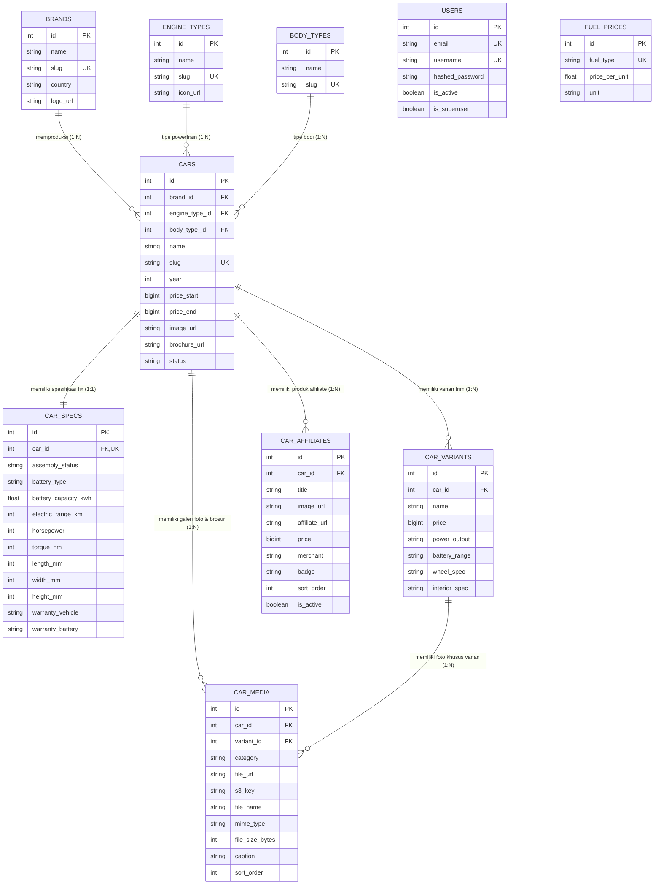

# DOKUMENTASI SPESIFIKASI FILE, STRUKTUR KODE, DAN DESAIN DATABASE
**Portal Media Otomotif & CMS Kendaraan Listrik (EV Hub / EVnesia)**

---

## 2.3.3 Struktur Kode

Struktur kode merupakan aturan penamaan atau format identitas unik yang digunakan pada setiap data dalam sistem informasi CMS Otomotif. Tujuan utama dari penggunaan struktur kode adalah untuk mempermudah identifikasi data, mempercepat proses pencarian, menjaga konsistensi integritas referensial antar-tabel, serta menjadi standar penamaan aset pada penyimpanan cloud **S3 (Object Storage)**.

---

### 1. Format Kode Admin / Pengguna (User)
Kode admin digunakan sebagai identitas unik untuk setiap administrator dan editor dalam sistem CMS.

**Format Kode Admin:**
```text
┌───┬───┬───┬───┬───┬───┬───┐
│ A │ D │ M │ - │ 0 │ 0 │ 1 │
└───┴───┴───┴───┴───┴───┴───┘
  │   │   │       │   │   │
  └───┬───┘       └───┬───┘
Inisial Admin     Nomor Urut Admin
```
* **Keterangan:**
  * `ADM` : Tiga karakter alfabet penanda entitas Admin.
  * `-`   : Tanda pemisah (*delimiter*).
  * `001` : Tiga digit angka nomor urut admin (001 - 999).
* **Contoh:** `ADM-001`, `ADM-002`.

---

### 2. Format Kode Merek Kendaraan (Brand)
Kode merek digunakan untuk mengidentifikasi pabrikan/APM kendaraan listrik maupun konvensional.

**Format Kode Brand:**
```text
┌───┬───┬───┬───┬───┬───┬───┐
│ B │ R │ D │ - │ 0 │ 0 │ 1 │
└───┴───┴───┴───┴───┴───┴───┘
  │   │   │       │   │   │
  └───┬───┘       └───┬───┘
Inisial Brand     Nomor Urut Brand
```
* **Keterangan:**
  * `BRD` : Tiga karakter penanda entitas Brand / Merek.
  * `-`   : Tanda pemisah.
  * `001` : Tiga digit nomor urut brand (cth: 001 = BYD, 002 = Hyundai, 003 = Wuling, 004 = MG).
* **Contoh:** `BRD-001`, `BRD-002`.

---

### 3. Format Kode Master Model Mobil (Car)
Kode mobil digunakan sebagai identitas unik unit model kendaraan (induk dari seluruh varian dan spesifikasi teknis).

**Format Kode Mobil:**
```text
┌───┬───┬───┬───┬───┬───┬───┬───┬───┬───┐
│ M │ O │ B │ - │ B │ R │ D │ - │ 0 │ 1 │
└───┴───┴───┴───┴───┴───┴───┴───┴───┴───┘
  │   │   │       │   │   │       │   │
  └───┬───┘       └───┬───┘       └───┬───┘
Inisial Mobil    Kode Brand     Nomor Urut Model
```
* **Keterangan:**
  * `MOB` : Tiga karakter penanda entitas Mobil (Model).
  * `BRD` : Tiga karakter singkatan brand (misal `BYD`, `HYU`, `WUL`, `TYT`).
  * `01`  : Dua digit nomor urut model kendaraan pada brand tersebut.
* **Contoh:** 
  * `MOB-BYD-01` (BYD Seal)
  * `MOB-HYU-01` (Hyundai Ioniq 5)
  * `MOB-WUL-02` (Wuling Binguo EV)

---

### 4. Format Kode Varian / Trim Kendaraan (Car Variant)
Kode varian digunakan untuk membedakan tingkatan tipe/trim kemewahan dan kapasitas baterai dari satu model mobil.

**Format Kode Varian:**
```text
┌───┬───┬───┬───┬───┬───┬───┬───┬───┬───┐
│ V │ A │ R │ - │ M │ O │ B │ - │ 0 │ 1 │
└───┴───┴───┴───┴───┴───┴───┴───┴───┴───┘
  │   │   │       │   │   │       │   │
  └───┬───┘       └───┬───┘       └───┬───┘
Inisial Varian   Nomor Mobil     Nomor Urut Trim
```
* **Keterangan:**
  * `VAR` : Tiga karakter penanda Varian/Trim.
  * `MOB` : Tiga digit ID/nomor mobil induk.
  * `01`  : Nomor urut varian (01 = Standard Range, 02 = Long Range, 03 = Performance AWD).
* **Contoh:** 
  * `VAR-001-01` (BYD Seal Dynamic)
  * `VAR-001-02` (BYD Seal Premium)
  * `VAR-001-03` (BYD Seal Performance AWD)

---

### 5. Format Kode Media & Berkas S3 (Car Media / Cloud Asset)
Kode media digunakan sebagai identitas aset gambar dan dokumen yang tersimpan pada Object Storage (S3). Kode ini sekaligus menentukan folder penempatan di S3.

**Format Kode Media S3:**
```text
┌───┬───┬───┬───┬───┬───┬───┬───┬───┬───┬───┬───┐
│ M │ E │ D │ - │ K │ A │ T │ - │ 0 │ 0 │ 0 │ 1 │
└───┴───┴───┴───┴───┴───┴───┴───┴───┴───┴───┴───┘
  │   │   │       │   │   │       │   │   │   │
  └───┬───┘       └───┬───┘       └─────┬─────┘
Inisial Media  Kategori Foto     Nomor Urut File
```
* **Kategori Foto (`KAT`):**
  * `HER` : *Hero / Studio Cutout* (Foto utama katalog mobil)
  * `EXT` : *Exterior* (Tampak depan, belakang, velg, grill, lampu)
  * `INT` : *Interior* (Dashboard, kursi, kemudi, konsol tengah)
  * `FET` : *Features* (Layar MID, ADAS, socket charging, panoramic roof)
  * `DOC` : *Document* (Brosur digital PDF resmi APM)
* **Contoh:** 
  * `MED-HER-0001` (Foto utama BYD Seal)
  * `MED-INT-0042` (Foto kabin interior Wuling Cloud EV)
  * `MED-DOC-0003` (Brosur PDF Ioniq 5 N)

---

### 6. Format Kode Tarif Energi (Fuel & Electricity Price)
Kode tarif energi digunakan untuk mengidentifikasi standar acuan harga BBM per liter dan tarif SPKLU per kWh pada kalkulator simulasi biaya operasional.

**Format Kode Tarif Energi:**
```text
┌───┬───┬───┬───┬───┬───┐
│ F │ U │ L │ - │ 0 │ 1 │
└───┴───┴───┴───┴───┴───┘
  │   │   │       │   │
  └───┬───┘       └───┬──┘
Inisial Energi   Nomor Urut
```
* **Keterangan:**
  * `FUL` : Tiga karakter penanda entitas Fuel / Energy Tarif.
  * `01`  : Dua digit nomor jenis energi (01 = SPKLU Home Charging, 02 = SPKLU Fast Charging, 03 = Pertalite RON 90, 04 = Pertamax RON 92, 05 = Pertamax Turbo RON 98, 06 = Solar/Dexlite).
* **Contoh:** `FUL-01`, `FUL-02`.

---

### 7. Format Kode Produk Affiliate & Aksesoris Mobil
Kode affiliate digunakan untuk mengidentifikasi produk aksesoris resmi atau aftermarket yang relevan khusus untuk model mobil tertentu.

**Format Kode Affiliate:**
```text
┌───┬───┬───┬───┬───┬───┬───┬───┬───┬───┐
│ A │ F │ L │ - │ M │ O │ B │ - │ 0 │ 1 │
└───┴───┴───┴───┴───┴───┴───┴───┴───┴───┘
  │   │   │       │   │   │       │   │
  └───┬───┘       └───┬───┘       └───┬───┘
Inisial Affiliate  ID Mobil    Nomor Produk
```
* **Keterangan:**
  * `AFL` : Tiga karakter penanda entitas Produk Affiliate / Aksesoris.
  * `MOB` : Tiga digit ID/nomor mobil terkait (foreign key).
  * `01`  : Nomor urut produk untuk mobil tersebut (01, 02, 03...).
* **Contoh:** 
  * `AFL-001-01` (Produk ke-1 untuk Mobil ID 1: Portable Charger EV 7kW)
  * `AFL-001-02` (Produk ke-2 untuk Mobil ID 1: Karpet 5D Custom)

---

## 2. Spesifikasi File Sistem (Data Dictionary)

Spesifikasi file menggambarkan detail struktur fisik tabel database relasional, tipe data, panjang field, dan relasi integritas antar-tabel yang digunakan pada backend FastAPI dan terhubung ke frontend Astro.

---

### 2.1 Spesifikasi File Pengguna (User / Administrator)

#### a. Struktur File Pengguna:
* **Nama File**      : Pengguna / Administrator
* **Akronim**        : `users.MYD`
* **Tipe File**      : File Master
* **Akses File**     : Random
* **Panjang Record** : 476 bytes
* **Field Key**      : `id` (Primary Key)
* **Software**       : MySQL / PostgreSQL / SQLite

#### b. Struktur Tabel Pengguna:
**Tabel II.1 Struktur Tabel Pengguna (`users`)**

| No | Elemen Data | Akronim | Tipe | Panjang | Keterangan |
|:--:|:---|:---|:---:|:---:|:---|
| 1 | ID Pengguna | `id` | Integer | 11 | Primary Key, Auto Increment |
| 2 | Alamat Email | `email` | Varchar | 100 | Unique, Not Null |
| 3 | Username | `username` | Varchar | 50 | Unique, Not Null |
| 4 | Nama Lengkap | `full_name` | Varchar | 100 | Nullable |
| 5 | Password Terenkripsi | `hashed_password` | Varchar | 255 | Bcrypt Hash, Not Null |
| 6 | Status Akun Aktif | `is_active` | Boolean | 1 | Default: True |
| 7 | Status Super Admin | `is_superuser` | Boolean | 1 | Default: False |
| 8 | Waktu Dibuat | `created_at` | DateTime | 8 | Default: Current Timestamp |
| 9 | Waktu Diperbarui | `updated_at` | DateTime | 8 | On Update: Current Timestamp |

---

### 2.2 Spesifikasi File Merek Kendaraan (Brand)

#### a. Struktur File Merek Kendaraan:
* **Nama File**      : Merek Kendaraan
* **Akronim**        : `brands.MYD`
* **Tipe File**      : File Master
* **Akses File**     : Random
* **Panjang Record** : 796 bytes
* **Field Key**      : `id` (Primary Key)
* **Software**       : MySQL / PostgreSQL / SQLite

#### b. Struktur Tabel Merek Kendaraan:
**Tabel II.2 Struktur Tabel Merek Kendaraan (`brands`)**

| No | Elemen Data | Akronim | Tipe | Panjang | Keterangan |
|:--:|:---|:---|:---:|:---:|:---|
| 1 | ID Merek | `id` | Integer | 11 | Primary Key, Auto Increment |
| 2 | Nama Merek | `name` | Varchar | 100 | Not Null (cth: "BYD", "Hyundai") |
| 3 | Slug URL Merek | `slug` | Varchar | 100 | Unique, Indexed, Not Null |
| 4 | Negara Asal | `country` | Varchar | 80 | Nullable (cth: "Tiongkok", "Korea Selatan") |
| 5 | URL Logo Merek (S3) | `logo_url` | Varchar | 500 | Nullable (Public CDN S3 URL) |
| 6 | Waktu Dibuat | `created_at` | DateTime | 8 | Default: Current Timestamp |
| 7 | Waktu Diperbarui | `updated_at` | DateTime | 8 | On Update: Current Timestamp |

---

### 2.3 Spesifikasi File Tipe Penggerak (Engine Type)

#### a. Struktur File Tipe Penggerak:
* **Nama File**      : Tipe Penggerak Kendaraan
* **Akronim**        : `engine_types.MYD`
* **Tipe File**      : File Referensi / Parameter
* **Akses File**     : Random
* **Panjang Record** : 611 bytes
* **Field Key**      : `id` (Primary Key)
* **Software**       : MySQL / PostgreSQL / SQLite

#### b. Struktur Tabel Tipe Penggerak:
**Tabel II.3 Struktur Tabel Tipe Penggerak (`engine_types`)**

| No | Elemen Data | Akronim | Tipe | Panjang | Keterangan |
|:--:|:---|:---|:---:|:---:|:---|
| 1 | ID Tipe Penggerak | `id` | Integer | 11 | Primary Key, Auto Increment |
| 2 | Nama Tipe Penggerak | `name` | Varchar | 50 | Not Null ("BEV", "PHEV", "Hybrid", "ICE") |
| 3 | Slug Penggerak | `slug` | Varchar | 50 | Unique, Not Null ("bev", "phev", "hybrid") |
| 4 | URL Ikon (S3) | `icon_url` | Varchar | 500 | Nullable |

---

### 2.4 Spesifikasi File Tipe Bodi (Body Type)

#### a. Struktur File Tipe Bodi:
* **Nama File**      : Tipe Bodi Kendaraan
* **Akronim**        : `body_types.MYD`
* **Tipe File**      : File Referensi / Parameter
* **Akses File**     : Random
* **Panjang Record** : 111 bytes
* **Field Key**      : `id` (Primary Key)
* **Software**       : MySQL / PostgreSQL / SQLite

#### b. Struktur Tabel Tipe Bodi:
**Tabel II.4 Struktur Tabel Tipe Bodi (`body_types`)**

| No | Elemen Data | Akronim | Tipe | Panjang | Keterangan |
|:--:|:---|:---|:---:|:---:|:---|
| 1 | ID Tipe Bodi | `id` | Integer | 11 | Primary Key, Auto Increment |
| 2 | Nama Tipe Bodi | `name` | Varchar | 50 | Not Null ("SUV", "Sedan", "MPV", "Hatchback") |
| 3 | Slug Tipe Bodi | `slug` | Varchar | 50 | Unique, Not Null ("suv", "sedan", "mpv") |

---

### 2.5 Spesifikasi File Mobil Master (Car)

#### a. Struktur File Mobil Master:
* **Nama File**      : Master Model Kendaraan
* **Akronim**        : `cars.MYD`
* **Tipe File**      : File Master
* **Akses File**     : Random
* **Panjang Record** : 2.520 bytes
* **Field Key**      : `id` (Primary Key)
* **Software**       : MySQL / PostgreSQL / SQLite

#### b. Struktur Tabel Mobil Master:
**Tabel II.5 Struktur Tabel Mobil Master (`cars`)**

| No | Elemen Data | Akronim | Tipe | Panjang | Keterangan |
|:--:|:---|:---|:---:|:---:|:---|
| 1 | ID Mobil | `id` | Integer | 11 | Primary Key, Auto Increment |
| 2 | ID Merek | `brand_id` | Integer | 11 | Foreign Key -> `brands.id`, On Delete Cascade |
| 3 | ID Tipe Penggerak | `engine_type_id` | Integer | 11 | Foreign Key -> `engine_types.id` |
| 4 | ID Tipe Bodi | `body_type_id` | Integer | 11 | Foreign Key -> `body_types.id`, Nullable |
| 5 | Nama Model Mobil | `name` | Varchar | 200 | Not Null (cth: "Seal", "Ioniq 5") |
| 6 | Slug URL Model | `slug` | Varchar | 200 | Unique, Indexed, Not Null |
| 7 | Tahun Model / Rilis | `year` | Integer | 4 | Not Null (cth: 2024, 2025) |
| 8 | Rentang Harga Awal | `price_start` | BigInteger | 8 | Nullable (Rupiah, cth: 629000000) |
| 9 | Rentang Harga Akhir | `price_end` | BigInteger | 8 | Nullable (Rupiah, cth: 719000000) |
| 10 | Tagline Model | `tagline` | Varchar | 300 | Nullable |
| 11 | Deskripsi Ringkasan | `description` | Text | - | Nullable |
| 12 | URL Foto Utama (S3) | `image_url` | Varchar | 500 | Nullable (Hero CDN S3 URL) |
| 13 | URL Thumbnail (S3) | `thumbnail_url` | Varchar | 500 | Nullable |
| 14 | URL Brosur PDF (S3) | `brochure_url` | Varchar | 500 | Nullable (S3 Document URL) |
| 15 | Status Unggulan | `is_featured` | Boolean | 1 | Default: False |
| 16 | Status Mobil Baru | `is_new` | Boolean | 1 | Default: True |
| 17 | Status Publikasi | `status` | Enum | 15 | 'active', 'draft', 'discontinued' |
| 18 | Galeri JSON Cadangan | `gallery_json` | Text | - | Nullable (Legacy fallback) |
| 19 | Waktu Dibuat | `created_at` | DateTime | 8 | Default: Current Timestamp |
| 20 | Waktu Diperbarui | `updated_at` | DateTime | 8 | On Update: Current Timestamp |

---

### 2.6 Spesifikasi File Spesifikasi Teknis Mobil (Car Spec - Informasi Fix)

#### a. Struktur File Spesifikasi Teknis:
* **Nama File**      : Spesifikasi Teknis Fix Kendaraan
* **Akronim**        : `car_specs.MYD`
* **Tipe File**      : File Master Rinci
* **Akses File**     : Random
* **Panjang Record** : 3.840 bytes
* **Field Key**      : `id` (Primary Key)
* **Software**       : MySQL / PostgreSQL / SQLite

#### b. Struktur Tabel Spesifikasi Teknis Mobil:
**Tabel II.6 Struktur Tabel Spesifikasi Teknis (`car_specs`)**

| No | Elemen Data | Akronim | Tipe | Panjang | Keterangan |
|:--:|:---|:---|:---:|:---:|:---|
| 1 | ID Spesifikasi | `id` | Integer | 11 | Primary Key, Auto Increment |
| 2 | ID Mobil | `car_id` | Integer | 11 | Unique, Foreign Key -> `cars.id`, On Delete Cascade |
| 3 | Status Perakitan | `assembly_status` | Varchar | 50 | Nullable ("CKD", "CBU", "TKDN 40%") |
| 4 | Jenis Baterai Standar | `battery_type` | Varchar | 100 | Nullable ("LFP Blade Battery", "NMC") |
| 5 | Kapasitas Baterai Bawaan | `battery_capacity_kwh` | Float | - | Nullable (kWh) |
| 6 | Jarak Tempuh EV Bawaan | `electric_range_km` | Integer | 6 | Nullable (km) |
| 7 | Standar Uji Jarak | `range_standard` | Varchar | 50 | Default: "WLTP" (NEDC, WLTP, CLTC, EPA) |
| 8 | Dukungan V2L | `v2l_support` | Varchar | 100 | Nullable ("Ya, 3.3 kW V2L Luar & Dalam") |
| 9 | Konsumsi Energi | `energy_consumption` | Varchar | 100 | Nullable ("14.2 kWh/100 km") |
| 10 | Nama Mesin / Powertrain | `engine_name` | Varchar | 200 | Nullable |
| 11 | Kapasitas Mesin Bensin | `engine_capacity_cc` | Integer | 6 | Nullable (None jika Full EV / BEV) |
| 12 | Tenaga Maksimal (HP) | `horsepower` | Integer | 6 | Nullable (Horsepower) |
| 13 | Torsi Maksimal (Nm) | `torque_nm` | Integer | 6 | Nullable (Newton Meter) |
| 14 | Transmisi | `transmission` | Varchar | 100 | Nullable ("Single Reduction Gear") |
| 15 | Sistem Penggerak Roda | `drivetrain` | Varchar | 50 | Nullable ("RWD", "AWD", "FWD") |
| 16 | Akselerasi 0-100 km/j | `acceleration_0_100` | Float | - | Nullable (detik) |
| 17 | Kecepatan Puncak | `top_speed_kmh` | Integer | 4 | Nullable (km/jam) |
| 18 | Konsumsi BBM | `fuel_consumption_kmpl` | Float | - | Nullable (km/liter, jika Hybrid/PHEV) |
| 19 | Panjang Mobil (mm) | `length_mm` | Integer | 6 | Nullable |
| 20 | Lebar Mobil (mm) | `width_mm` | Integer | 6 | Nullable |
| 21 | Tinggi Mobil (mm) | `height_mm` | Integer | 6 | Nullable |
| 22 | Jarak Sumbu Roda (mm) | `wheelbase_mm` | Integer | 6 | Nullable |
| 23 | Ground Clearance (mm) | `ground_clearance_mm` | Integer | 4 | Nullable |
| 24 | Berat Kosong (kg) | `curb_weight_kg` | Integer | 6 | Nullable |
| 25 | Kapasitas Tempat Duduk | `seating_capacity` | Integer | 2 | Nullable (cth: 5, 7) |
| 26 | Volume Bagasi (Liter) | `trunk_volume_liters` | Integer | 6 | Nullable |
| 27 | Kapasitas Tangki BBM | `fuel_tank_liters` | Integer | 4 | Nullable (Liters) |
| 28 | Layar Kluster Speedo | `cluster_display` | Varchar | 150 | Nullable ("10.25-inch Digital TFT") |
| 29 | Opsi Warna Resmi APM | `colors_json` | Text | - | Nullable (Array Warna & Hex) |
| 30 | Jumlah Airbag | `airbags` | Integer | 2 | Nullable (cth: 6, 7, 8) |
| 31 | Rem ABS & EBD | `abs_ebd` | Boolean | 1 | Default: True |
| 32 | Kontrol Stabilitas (ESC) | `esc` | Boolean | 1 | Default: True |
| 33 | Fitur ADAS Aktif | `adas` | Boolean | 1 | Default: False |
| 34 | Nama Paket ADAS | `adas_name` | Varchar | 100 | Nullable ("Toyota Safety Sense 3.0") |
| 35 | Daftar Fitur ADAS | `adas_features_json` | Text | - | Nullable (JSON Array ADAS) |
| 36 | Garansi Kendaraan | `warranty_vehicle` | Varchar | 100 | Nullable ("6 Tahun / 150.000 km") |
| 37 | Garansi Baterai EV | `warranty_battery` | Varchar | 100 | Nullable ("8 Tahun / 160.000 km") |
| 38 | Paket Charger Rumah | `wall_charger_info` | Varchar | 200 | Nullable ("Gratis 7 kW + Pasang") |
| 39 | Estimasi Pajak Tahunan | `annual_tax_estimate` | BigInteger | 8 | Nullable (Rupiah PKB Tahunan) |

---

### 2.7 Spesifikasi File Varian / Trim Mobil (Car Variant - Pembeda Trim)

#### a. Struktur File Varian Mobil:
* **Nama File**      : Varian / Trim Kendaraan
* **Akronim**        : `car_variants.MYD`
* **Tipe File**      : File Master Rinci
* **Akses File**     : Random
* **Panjang Record** : 3.120 bytes
* **Field Key**      : `id` (Primary Key)
* **Software**       : MySQL / PostgreSQL / SQLite

#### b. Struktur Tabel Varian Mobil:
**Tabel II.7 Struktur Tabel Varian Mobil (`car_variants`)**

| No | Elemen Data | Akronim | Tipe | Panjang | Keterangan |
|:--:|:---|:---|:---:|:---:|:---|
| 1 | ID Varian | `id` | Integer | 11 | Primary Key, Auto Increment |
| 2 | ID Mobil | `car_id` | Integer | 11 | Foreign Key -> `cars.id`, On Delete Cascade |
| 3 | Nama Varian / Trim | `name` | Varchar | 200 | Not Null (cth: "Extended Range", "Performance") |
| 4 | Harga Resmi OTR | `price` | BigInteger | 8 | Not Null (Rupiah, cth: 719000000) |
| 5 | Ringkasan Keunggulan | `highlights` | Text | - | Nullable |
| 6 | Output Tenaga Varian | `power_output` | Varchar | 100 | Nullable ("320 HP / 605 Nm Dual Motor") |
| 7 | Kapasitas & Jarak Varian | `battery_range` | Varchar | 100 | Nullable ("Baterai 82.5 kWh / 570 km WLTP") |
| 8 | Standar Uji Jarak | `range_standard` | Varchar | 50 | Nullable ("WLTP", "NEDC", "CLTC") |
| 9 | Jenis Baterai Varian | `battery_type` | Varchar | 100 | Nullable |
| 10 | Dukungan V2L Varian | `v2l_support` | Varchar | 100 | Nullable |
| 11 | Waktu Pengecasan DC/AC | `charging_time` | Varchar | 100 | Nullable ("DC 150 kW: 10-80% 30 mnt") |
| 12 | Paket Charger Rumah | `wall_charger_info` | Varchar | 200 | Nullable |
| 13 | Spesifikasi Velg & Ban | `wheel_spec` | Varchar | 200 | Nullable ("Alloy 19-inch 235/45 R19") |
| 14 | Jok & Material Kabin | `interior_spec` | Varchar | 200 | Nullable ("Jok Kulit Ventilasi + Memory") |
| 15 | Konfigurasi Kursi | `seating_layout` | Varchar | 100 | Nullable ("5-Seater" / "6-Seater Captain") |
| 16 | Layar Speedometer MID | `cluster_display` | Varchar | 150 | Nullable |
| 17 | Layar Head Unit & Audio | `audio_display` | Varchar | 200 | Nullable ("15.6 Rotating + Dynaudio") |
| 18 | Fitur Pintu Bagasi | `tailgate_feature` | Varchar | 150 | Nullable ("Power Tailgate Kick Sensor") |
| 19 | Tipe Sunroof | `sunroof` | Varchar | 100 | Nullable ("Panoramic Glass Roof") |
| 20 | Telematika / Aplikasi HP | `telematics_feature` | Varchar | 150 | Nullable ("BYD App Remote AC & GPS") |
| 21 | Kamera Parkir & Vision | `camera_vision` | Varchar | 150 | Nullable ("360 HD 3D Surround View") |
| 22 | Tipe Lampu Depan | `lighting_spec` | Varchar | 150 | Nullable ("Matrix Full LED Projector") |
| 23 | AC & Pembersih Udara | `climate_air` | Varchar | 150 | Nullable ("Dual Zone + PM2.5 Filter") |
| 24 | Fitur Ekstra Kenyamanan | `convenience_extras` | Varchar | 200 | Nullable ("Dual Wireless Charger 50W") |
| 25 | Body Kit & Eksterior | `styling_kit` | Varchar | 150 | Nullable |
| 26 | Fitur ADAS Khusus Trim | `safety_adas` | Varchar | 200 | Nullable |
| 27 | Pajak Tahunan Varian | `annual_tax` | BigInteger | 8 | Nullable |
| 28 | Galeri JSON Trim | `gallery_json` | Text | - | Nullable |

---

### 2.8 Spesifikasi File Media & Foto S3 (Car Media - Standar Cloud Baru)

#### a. Struktur File Media & Foto:
* **Nama File**      : Media, Foto & Berkas S3 Kendaraan
* **Akronim**        : `car_media.MYD`
* **Tipe File**      : File Transaksi / Media
* **Akses File**     : Random
* **Panjang Record** : 1.348 bytes
* **Field Key**      : `id` (Primary Key)
* **Software**       : MySQL / PostgreSQL / SQLite

#### b. Struktur Tabel Media & Foto S3:
**Tabel II.8 Struktur Tabel Media & Foto S3 (`car_media`)**

| No | Elemen Data | Akronim | Tipe | Panjang | Keterangan |
|:--:|:---|:---|:---:|:---:|:---|
| 1 | ID Media | `id` | Integer | 11 | Primary Key, Auto Increment |
| 2 | ID Mobil | `car_id` | Integer | 11 | Foreign Key -> `cars.id`, On Delete Cascade |
| 3 | ID Varian (Opsional) | `variant_id` | Integer | 11 | Foreign Key -> `car_variants.id`, On Delete Set Null |
| 4 | Kategori Media | `category` | Enum | 20 | 'hero', 'exterior', 'interior', 'feature', 'brochure' |
| 5 | Public URL Cloud S3 | `file_url` | Varchar | 500 | Not Null (cth: `https://cdn.domain.com/cars/...`) |
| 6 | S3 Object Key | `s3_key` | Varchar | 300 | Not Null (Kunci unik internal S3 untuk delete) |
| 7 | Nama File Asli | `file_name` | Varchar | 200 | Not Null (Nama file saat diunggah) |
| 8 | Tipe MIME Berkas | `mime_type` | Varchar | 50 | Not Null ('image/webp', 'application/pdf') |
| 9 | Ukuran File (Bytes) | `file_size_bytes` | Integer | 11 | Ukuran file sebenarnya dalam bytes |
| 10 | Judul / Keterangan | `caption` | Varchar | 200 | Nullable (Keterangan alt text gambar) |
| 11 | Urutan Tampil | `sort_order` | Integer | 4 | Default: 1 (Urutan foto di galeri slider) |
| 12 | Status Tampil Publik | `is_active` | Boolean | 1 | Default: True |
| 13 | Waktu Unggah | `created_at` | DateTime | 8 | Default: Current Timestamp |

---

### 2.9 Spesifikasi File Tarif Energi Default (Fuel & Energy Price)

#### a. Struktur File Tarif Energi:
* **Nama File**      : Tarif Default Energi (BBM & SPKLU)
* **Akronim**        : `fuel_prices.MYD`
* **Tipe File**      : File Parameter / Konfigurasi
* **Akses File**     : Random
* **Panjang Record** : 115 bytes
* **Field Key**      : `id` (Primary Key)
* **Software**       : MySQL / PostgreSQL / SQLite

#### b. Struktur Tabel Tarif Energi:
**Tabel II.9 Struktur Tabel Tarif Energi (`fuel_prices`)**

| No | Elemen Data | Akronim | Tipe | Panjang | Keterangan |
|:--:|:---|:---|:---:|:---:|:---|
| 1 | ID Tarif | `id` | Integer | 11 | Primary Key, Auto Increment |
| 2 | Tipe Bahan Bakar / Listrik | `fuel_type` | Varchar | 50 | Unique, Not Null ("spklu_home", "pertalite") |
| 3 | Harga Per Unit (Rp) | `price_per_unit` | Float | - | Not Null (cth: 2466.0, 10000.0) |
| 4 | Satuan Ukuran | `unit` | Varchar | 20 | Default: "kWh" atau "L" |
| 5 | Waktu Pembaruan Terakhir | `updated_at` | DateTime | 8 | On Update: Current Timestamp |

---

### 2.10 Spesifikasi File Produk Affiliate Mobil (Car Affiliate)

#### a. Struktur File Produk Affiliate:
* **Nama File**      : Produk Affiliate & Aksesoris Kendaraan
* **Akronim**        : `car_affiliates.MYD`
* **Tipe File**      : File Transaksi / Relasi
* **Akses File**     : Random
* **Panjang Record** : 1.354 bytes
* **Field Key**      : `id` (Primary Key)
* **Software**       : MySQL / PostgreSQL / SQLite

#### b. Struktur Tabel Produk Affiliate Mobil:
**Tabel II.10 Struktur Tabel Produk Affiliate Mobil (`car_affiliates`)**

| No | Elemen Data | Akronim | Tipe | Panjang | Keterangan |
|:--:|:---|:---|:---:|:---:|:---|
| 1 | ID Affiliate | `id` | Integer | 11 | Primary Key |
| 2 | ID Mobil | `car_id` | Integer | 11 | Foreign Key (`cars.id`) |
| 3 | Judul Produk | `title` | Varchar | 200 | - |
| 4 | URL Gambar Produk | `image_url` | Varchar | 500 | - |
| 5 | Tautan Link Affiliate | `affiliate_url` | Varchar | 500 | - |
| 6 | Harga Produk (Rp) | `price` | BigInteger | 20 | - |
| 7 | Platform / Marketplace | `merchant` | Varchar | 50 | - |
| 8 | Label / Badge Produk | `badge` | Varchar | 50 | - |
| 9 | Deskripsi Singkat | `description` | Text | - | - |
| 10 | Urutan Tampil | `sort_order` | Integer | 4 | - |
| 11 | Status Aktif | `is_active` | Boolean | 1 | - |
| 12 | Waktu Dibuat | `created_at` | DateTime | 8 | - |
| 13 | Waktu Diperbarui | `updated_at` | DateTime | 8 | - |

---

## 3. Desain Arsitektur & Hierarki Folder Cloud Storage (S3)

Agar aset file media pada Amazon S3 / Cloudflare R2 tertata rapi, terstandarisasi, dan mudah di-audit, struktur folder penempatan file diatur menggunakan aturan hierarki berikut:

```text
s3://bucket-evhub-media/
│
├── brands/
│   └── {brand_slug}/
│       └── logo_{uuid}.webp              -> Logo resmi merek mobil
│
├── cars/
│   └── {brand_slug}/
│       └── {car_slug}/
│           ├── hero/
│           │   └── hero_{uuid}.webp      -> Foto utama untuk card & thumbnail katalog
│           ├── exterior/
│           │   └── ext_{uuid}_{nama}.webp -> Galeri eksterior (depan, samping, velg)
│           ├── interior/
│           │   └── int_{uuid}_{nama}.webp -> Galeri interior (dashboard, jok, bagasi)
│           ├── features/
│           │   └── feat_{uuid}_{nama}.webp-> Foto fitur detail (layar, sunroof, V2L)
│           └── documents/
│               └── brochure_{uuid}.pdf   -> Brosur resmi dalam format PDF
```

### Mekanisme Pengunggahan & Penghapusan S3 (Lifecycle):
1. **Upload Handler:** Backend menerima file gambar -> Melakukan validasi ekstensi (`webp`, `jpg`, `png`, `pdf`) dan ukuran maksimal -> Mengunggah stream file ke S3 dengan prefix path sesuai kategori -> Mendapatkan Public URL -> Menyimpan record ke tabel `car_media`.
2. **Delete Handler (Anti File-Hantu):** Ketika admin menghapus foto atau menghapus sebuah mobil:
   * Backend membaca field `s3_key` dari tabel `car_media`.
   * Backend mengirim perintah `s3_client.delete_object(Bucket=..., Key=s3_key)`.
   * Record di database dihapus secara *Cascade*.

---

## 4. Diagram Relasi Entitas Database (Entity Relationship Diagram - ERD)



---

## 2.3.4 Arsitektur Cloud Supabase (Database & Storage)

Sistem telah sepenuhnya dimigrasikan dari penyimpanan lokal/SQLite ke arsitektur **Cloud Murni (Serverless Supabase)** tanpa ketergantungan pada disk lokal laptop:

### 1. Database Supabase PostgreSQL
* **Engine**: PostgreSQL 15+ (Hosted di region `ap-northeast-2` Seoul)
* **Session Pooler (IPv4 / IPv6)**: `aws-0-ap-northeast-2.pooler.supabase.com:5432/postgres`
* **Direct Connection**: `db.loukmpklgauzomyeysnf.supabase.co:5432/postgres`
* **Status**: 100% data aktif (146 Mobil, 240 Varian, 42 Merek, 145 Spesifikasi Teknis, 7 Produk Affiliate, 8 Harga Bahan Bakar).
* **Operasi Tambah / Edit / Hapus (CRUD)**: Langsung dieksekusi ke PostgreSQL Supabase secara realtime via SQLAlchemy ORM dan sinkron otomatis ke frontend JSON.

### 2. Supabase Storage (CDN Bucket: `car-assets`)
* **Bucket**: `car-assets` (Public Read Access)
* **CDN Endpoint**: `https://loukmpklgauzomyeysnf.supabase.co/storage/v1/object/public/car-assets/`
* **Status Migrasi**:
  * **Foto Mobil**: 146 foto studio/eksterior tersimpan di `cars/` (0 link lokal tersisa).
  * **Brosur Resmi**: 96 file PDF tersimpan di `brochures/` (0 link lokal tersisa). Brosur berukuran >50MB telah dioptimasi kompresi gambarnya sehingga seluruhnya aman tersimpan di cloud.
  * **Logo Brand**: 38 berkas SVG resmi tersimpan di `brands/` (0 link lokal tersisa).
* **Unggahan Baru Admin**: Setiap berkas baru yang diunggah melalui Dashboard Admin otomatis diunggah langsung ke Supabase Storage via modul `supabase_storage.py`.

---

## 2.3.5 Standarisasi Fitur Keselamatan (Safety Pasif vs Aktif vs ADAS)

Dalam CMS, spesifikasi keselamatan dipisahkan secara tegas dan sistematis menjadi 3 pilar:

1. **Keselamatan Pasif (Passive Safety)**:
   * Perlindungan saat benturan terjadi.
   * Meliputi: Jumlah Airbag (opsi cepat 2/6/7/9), Struktur Rangka (Ultra High Strength Steel), Uji Tabrak (ASEAN NCAP / Euro NCAP Bintang 5), ISOFIX Child Anchor, Pretensioner Seatbelt, EV Battery Cut-Off Sensor, dan Crash Auto-Unlock.

2. **Keselamatan Aktif Konvensional (Active Safety)**:
   * Sistem mekanikal-elektronik pencegah kehilangan kendali kendaraan.
   * Meliputi: ABS, EBD, Brake Assist (BA), Electronic Stability Control (ESC/VSC), Traction Control (TCS), Hill Start Assist (HSA), Hill Descent Control (HDC), Electric Parking Brake (EPB) + Auto Vehicle Hold (AVH), Tire Pressure Monitoring System (TPMS), dan Multi-Collision Brake (MCB).

3. **Sistem ADAS Cerdas (Advanced Driver Assistance Systems)**:
   * Fitur semi-otonom berbasis sensor radar/kamera yang dikonfigurasi **spesifik per trim varian**.
   * Dikelola dengan sistem checklist interaktif 25 fitur terpopuler dalam 5 pilar (Kecepatan & Jarak Adaptif, Pengereman Darurat & Tabrakan, Asisten Kemudi & Lajur, Blind Spot & Sekitar, serta Visibilitas & Parkir Cerdas).

